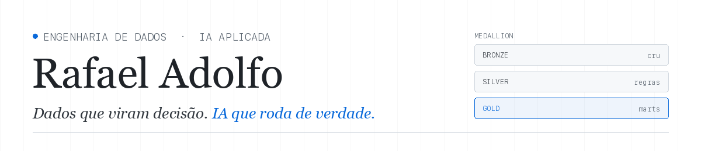

  <picture>
    <source media="(prefers-color-scheme: dark)" srcset="./assets/banner-dark.png">
    <source media="(prefers-color-scheme: light)" srcset="./assets/banner-light.png">
    
  </picture>

  
  
  

I work between data engineering and applied AI: I design the pipeline, model the layers and take the result to production — including an LLM running on a GPU-less VPS at zero marginal cost per query. I'm a **Junior Data Analyst** at **Master Internet**, where I automate critical processes and build the foundation decisions rely on, and a **Computer Engineering** student at **CEFET-MG**.

### ▸ How I work

- **Model before tooling.** Data contracts, layers and tests come before picking the service — that's what keeps a pipeline trustworthy when the schema changes.
- **AI only ships if it fits the budget.** I'd rather run a local SLM that answers in seconds than a per-token API that also exposes sensitive documents.
- **Operating is part of building.** Docker, nginx and CI/CD ship with the code; if it doesn't run in production, it isn't finished.

### ▸ Numbers

| **R$ 150k** | **10,632** | **0** |
|:---:|:---:|:---:|
| in fines avoided with the CEMIG automation bot | Protheus tables indexed for offline querying | GPU needed to serve NormaExtractor's local LLM |

### ▸ Selected work

| Project | What it solves | Stack |
|:---|:---|:---|
| **[NormaExtractor](https://github.com/Radsfer/normaextractor)**  [demo](https://normaextractor.adolfo.tec.br) | RAG pipeline over regulatory documents with a local CPU SLM: structured clause extraction, embeddings and chat with source citations, no third-party API | `FastAPI` `React` `ChromaDB` `llama.cpp` |
| **[Olist Lakehouse](https://github.com/Radsfer/olist-lakehouse-project)** | Medallion lakehouse in Databricks (PySpark + Delta Lake) with GenAI to classify reviews and fire Discord alerts | `PySpark` `Delta Lake` `Databricks` |
| **[ProdTrack](https://github.com/Radsfer/projeto_prs_tecnologia)** | Industrial production and telemetry ingestion, with an efficiency panel and export ready for Power BI/Fabric | `TypeScript` `IoT` `LGPD` |
| **[Logistics network optimizer](https://github.com/Radsfer/otimizador-de-malha-logistica)** | Facility location MILP with integrated inventory, instance validation and CLI + dashboard | `OR-Tools` `Pydantic` `Streamlit` |

### ▸ Stack

  
  
  
  
  
  
  

  
  
  
  
  
  

  
  
  
  
  
  

Fundamentals: C · C++ · Java · Verilog · optimization (MIP) · chemical engineering

### ▸ Experience & education

**Junior Data Analyst** · Master Internet · `Dec 2025 – present` 
Python automation of a critical CEMIG process (R$ 150k in fines avoided), Airbyte ingestion from SQL Server to PostgreSQL, dbt modeling and transformation with supplier-cost data marts by sector, and internal Streamlit products used in per-sector decisions.

**Computer Engineering** · CEFET-MG · `expected Dec 2027` 
**Chemical Engineering** · UNIFOR-MG · `2021` 
Fluent English (reading, writing and speaking).

### ▸ Now

- Writing the SRS for Gomo Coop.
- Studying AI model distillation.
- Reviewing LeetCode problem patterns.
- Writing about the process at [adolfo.tec.br](https://adolfo.tec.br).

---

  🇧🇷 <a href="README.md">Versão em português</a>

