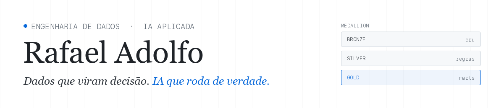

  <picture>
    <source media="(prefers-color-scheme: dark)" srcset="./assets/banner-dark.png">
    <source media="(prefers-color-scheme: light)" srcset="./assets/banner-light.png">
    
  </picture>

  
  
  

Trabalho entre engenharia de dados e IA aplicada: desenho o pipeline, modelo as camadas e levo o resultado até produção — inclusive um LLM rodando em VPS sem GPU, com custo marginal zero por consulta. Sou **Analista de Dados Jr** na **Master Internet**, onde automatizo processos críticos e construo a base que sustenta decisão, e curso **Engenharia da Computação** no **CEFET-MG**.

### ▸ Como eu trabalho

- **Modelo antes da ferramenta.** Contrato do dado, camadas e teste vêm antes da escolha do serviço — é o que mantém o pipeline confiável quando o schema muda.
- **IA só entra se couber no custo.** Prefiro um SLM local que responde em segundos a uma API que cobra por token e ainda expõe documento sensível.
- **Operar faz parte de construir.** Docker, nginx e CI/CD saem na mesma entrega do código; se não roda em produção, ainda não terminou.

### ▸ Números

| **R$ 150 mil** | **10.632** | **0** |
|:---:|:---:|:---:|
| em multas evitadas com o bot de automação da CEMIG | tabelas do Protheus indexadas para consulta offline | GPU necessária para servir o LLM local do NormaExtractor |

### ▸ Trabalho selecionado

| Projeto | O que resolve | Stack |
|:---|:---|:---|
| **[NormaExtractor](https://github.com/Radsfer/normaextractor)**  [demo](https://normaextractor.adolfo.tec.br) | Pipeline RAG sobre documentos normativos com SLM local em CPU: extração estruturada de cláusulas, embeddings e chat com citação de fontes, sem API de terceiro | `FastAPI` `React` `ChromaDB` `llama.cpp` |
| **[Olist Lakehouse](https://github.com/Radsfer/olist-lakehouse-project)** | Lakehouse Medallion no Databricks (PySpark + Delta Lake) com GenAI para classificar reviews e disparar alertas no Discord | `PySpark` `Delta Lake` `Databricks` |
| **[ProdTrack](https://github.com/Radsfer/projeto_prs_tecnologia)** | Ingestão de apontamento e telemetria industrial, com painel de eficiência e export pronto para Power BI/Fabric | `TypeScript` `IoT` `LGPD` |
| **[Otimizador de malha logística](https://github.com/Radsfer/otimizador-de-malha-logistica)** | MILP de localização de centros de distribuição com estoque integrado, validação de instância e CLI + dashboard | `OR-Tools` `Pydantic` `Streamlit` |

### ▸ Stack

  
  
  
  
  
  
  

  
  
  
  
  
  

  
  
  
  
  
  

Fundamentos: C · C++ · Java · Verilog · otimização (MIP) · engenharia química

### ▸ Experiência & formação

**Analista de Dados Jr** · Master Internet · `dez/2025 – atual` 
Automação do processo crítico da CEMIG em Python (R$ 150 mil em multas evitadas), ingestão com Airbyte entre SQL Server e PostgreSQL, modelagem e transformação em dbt com data marts de custo por setor, e produtos internos em Streamlit usados na decisão de cada área.

**Engenharia da Computação** · CEFET-MG · `previsão 12/2027` 
**Engenharia Química** · UNIFOR-MG · `2021` 
Inglês fluente (leitura, escrita e conversação).

### ▸ Agora

- Escrevendo o SRS da Gomo Coop.
- Estudando destilação de modelos de IA.
- Revisando padrões de problemas de LeetCode.
- Escrevendo sobre o processo em [adolfo.tec.br](https://adolfo.tec.br).

---

  🇺🇸 <a href="README-en.md">English version</a>

